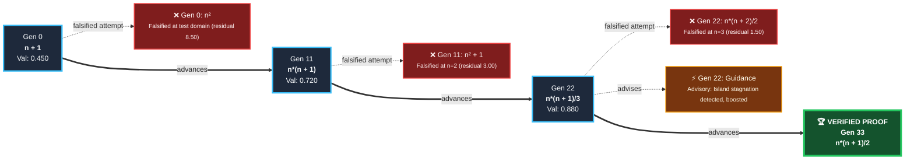

# Autonomous Mathematical Discoveries

**Total Verified Discoveries:** 19 theorems  
**Verification Engine:** 2-Tier Formal Induction (SymPy exact CAS certified)

---

## Summary Catalog

| ID | Theorem Name | Target Problem | Verified Closed Form | Proof Method | Gen |
|:---|:---|:---|:---|:---|:---:|
| `66ecf83a` | **Triangular Number Formula (Sum of 1..n)** | `$∑_{k=1}^n k$` | `$n*(n + 1)/2$` | mathematical_induction | 33 |
| `20ffa60a` | **Sum of Consecutive Odd Numbers** | `$∑_{k=1}^n (2k - 1)$` | `$n²$` | mathematical_induction | 1 |
| `269d535d` | **Harmonic Telescoping Series 1/(k(k+1))** | `$∑_{k=1}^n 1 / (k(k + 1))$` | `$n/(n + 1)$` | mathematical_induction | 12 |
| `afc88b04` | **Nicomachus's Theorem (Sum of First n Cubes)** | `$∑_{k=1}^n k³$` | `$L_20ff(L_66ec(n))$` | mathematical_induction | 0 |
| `d9d8906e` | **Shifted Harmonic Telescoping Series 1/((k+1)(k+2))** | `$∑_{k=1}^n 1 / ((k + 1)(k + 2))$` | `$L_269d(L_269d((n / 4)))$` | mathematical_induction | 12 |
| `89b844b2` | **Discrete Counting Identity** | `$∑_{k=1}^n 1$` | `$n$` | mathematical_induction | 0 |
| `43703130` | **Sum of Consecutive Even Numbers (Pronic Rectangles)** | `$∑_{k=1}^n 2k$` | `$(L_20ff(n) + n)$` | mathematical_induction | 6 |
| `c1f39bc7` | **Sum of Shifted Integers (k + 1)** | `$∑_{k=1}^n (k + 1)$` | `$(n + L_66ec(n))$` | mathematical_induction | 3 |
| `329d5175` | **Square Pyramidal Numbers (Sum of First n Squares)** | `$∑_{k=1}^n k²$` | `$n*(n + 1)*(2*n + 1)/6$` | mathematical_induction | 0 |
| `fdd75bec` | **Faulhaber Polynomial Degree 4 (Sum of Quartics)** | `$∑_{k=1}^n k⁴$` | `$n*(n + 1)*(2*n + 1)*(3*n² + 3*n - 1)/30$` | mathematical_induction | 0 |
| `cc201fc4` | **Generalized Pronic Sum Identity (∑ k(k + m))** | `$∑_{k=1}^n k(k + m)$` | `$n*(n + 1)*(3*m + 2*n + 1)/6$` | mathematical_induction | 0 |
| `07ab2421` | **Generalized Shifted Linear Sum (∑ (k + m))** | `$∑_{k=1}^n (k + m)$` | `$n*(2*m + n + 1)/2$` | mathematical_induction | 0 |
| `dfcbef41` | **Sum of Products of 3 Consecutive Integers (4-Simplex / Pentatope Numbers)** | `$∑_{k=1}^n k(k + 1)(k + 2)$` | `$n*(n + 1)*(n + 2)*(n + 3)/4$` | mathematical_induction | 0 |
| `168a7e59` | **Sum of Products of 4 Consecutive Integers (5-Simplex Numbers)** | `$∑_{k=1}^n k(k + 1)(k + 2)(k + 3)$` | `$n*(n + 1)*(n + 2)*(n + 3)*(n + 4)/5$` | mathematical_induction | 0 |
| `9674b097` | **Generalized Scaled Linear Sum (∑ c·k)** | `$∑_{k=1}^n c*k$` | `$c*n*(n + 1)/2$` | mathematical_induction | 0 |
| `a0f712bb` | **Sum of Squares of Consecutive Odd Numbers** | `$∑_{k=1}^n (2k - 1)²$` | `$n*(2*n - 1)*(2*n + 1)/3$` | mathematical_induction | 0 |
| `971a187a` | **Sum of Squares of Consecutive Even Numbers** | `$∑_{k=1}^n 4*k²$` | `$2*n*(n + 1)*(2*n + 1)/3$` | mathematical_induction | 0 |
| `a111b0e1` | **Telescoping Series of Odd Factor Products 1/((2k-1)(2k+1))** | `$∑_{k=1}^n 1 / ((2k + 1)(2k - 1))$` | `$L_269d(L_269d(n))$` | mathematical_induction | 2 |
| `51c0be34` | **Faulhaber Polynomial Degree 6 (Sum of Sextics)** | `$∑_{k=1}^n k⁶$` | `$n*(n + 1)*(2*n + 1)*(3*n⁴ + 6*n³ - 3*n + 1)/42$` | mathematical_induction | 0 |

---

## Detailed Discovery Profiles

### 1. Triangular Number Formula (Sum of 1..n) (`66ecf83a`)

- **Target Problem:** `$∑_{k=1}^n k$`
- **Closed Form (Modular):** `$n*(n + 1)/2$`
- **Dependencies:** None (Foundational Primitive)
- **Proof Method:** mathematical_induction (Discovered at Generation 33)

> [!NOTE]
> **Intuition & Geometric Meaning:**  
> This is the classical triangular number formula: 1 + 2 + ... + n = n(n+1)/2. Visually, pairing two identical step-pyramids of dots creates an n × (n+1) rectangle of n(n+1) dots; dividing this rectangle in half gives the exact sum of the first n positive integers.

```latex
\[ \sum_{k=1}^{n} k = \frac{n \left(n + 1\right)}{2} \]
```

### 2. Sum of Consecutive Odd Numbers (`20ffa60a`)

- **Target Problem:** `$∑_{k=1}^n (2k - 1)$`
- **Closed Form (Modular):** `$n²$`
- **Dependencies:** None (Foundational Primitive)
- **Proof Method:** mathematical_induction (Discovered at Generation 1)

> [!NOTE]
> **Intuition & Geometric Meaning:**  
> Summing the first n consecutive odd numbers (1 + 3 + 5 + ... + (2n-1)) always equals n². Geometrically, each successive odd number adds an L-shaped border (gnomon) around an existing square of unit tiles, expanding an n×n square into an (n+1)×(n+1) square.

```latex
\[ \sum_{k=1}^{n} \left(2 \cdot k - 1\right) = n^{2} \]
```

### 3. Harmonic Telescoping Series 1/(k(k+1)) (`269d535d`)

- **Target Problem:** `$∑_{k=1}^n 1 / (k(k + 1))$`
- **Closed Form (Modular):** `$n/(n + 1)$`
- **Dependencies:** None (Foundational Primitive)
- **Proof Method:** mathematical_induction (Discovered at Generation 12)

> [!NOTE]
> **Intuition & Geometric Meaning:**  
> This is a classic telescoping series: 1/(1·2) + 1/(2·3) + ... + 1/(n·(n+1)) = n/(n + 1). Using partial fractions, each term splits into (1/k - 1/(k+1)). When summed, all intermediate terms cancel out in pairs, leaving only the first and last parts: 1 - 1/(n+1) = n/(n + 1).

```latex
\[ \sum_{k=1}^{n} \frac{1}{k \cdot \left(k + 1\right)} = \frac{n}{n + 1} \]
```

### 4. Nicomachus's Theorem (Sum of First n Cubes) (`afc88b04`)

- **Target Problem:** `$∑_{k=1}^n k³$`
- **Closed Form (Modular):** `$L_20ff(L_66ec(n))$`
- **Expanded Polynomial:** `$n²*(n + 1)²/4$`
- **Dependencies:** `L_20ff, L_66ec`
- **Proof Method:** mathematical_induction (Discovered at Generation 0)

> [!NOTE]
> **Intuition & Geometric Meaning:**  
> This is Nicomachus's Theorem: the sum of the first n cubes (1³ + 2³ + ... + n³) is exactly equal to the square of the sum of the first n integers: [n(n+1)/2]² by composing previous lemmas (L_20ff, L_66ec). Intuitively, partitioning a large square of side n(n+1)/2 yields geometric regions whose areas match consecutive cubic blocks.

```latex
\[ \sum_{k=1}^{n} k^{3} = \mathrm{L_20ff}\left(\mathrm{L_66ec}\left(n\right)\right) \]
```

### 5. Shifted Harmonic Telescoping Series 1/((k+1)(k+2)) (`d9d8906e`)

- **Target Problem:** `$∑_{k=1}^n 1 / ((k + 1)(k + 2))$`
- **Closed Form (Modular):** `$L_269d(L_269d((n / 4)))$`
- **Expanded Polynomial:** `$n/(2*(n + 2))$`
- **Dependencies:** `L_269d`
- **Proof Method:** mathematical_induction (Discovered at Generation 12)

> [!NOTE]
> **Intuition & Geometric Meaning:**  
> This is a shifted telescoping series: 1/(2·3) + 1/(3·4) + ... + 1/((n+1)(n+2)) = L_269d(L_269d((n / 4))) by composing previous lemmas (L_269d). Decomposing each term via partial fractions into (1/(k+1) - 1/(k+2)) causes all interior terms to cancel out, leaving only the boundary terms 1/2 - 1/(n+2) = L_269d(L_269d((n / 4))).

```latex
\[ \sum_{k=1}^{n} \frac{1}{\left(k + 1\right) \cdot \left(k + 2\right)} = \mathrm{L_269d}\left(\mathrm{L_269d}\left(\frac{n}{4}\right)\right) \]
```

### 6. Discrete Counting Identity (`89b844b2`)

- **Target Problem:** `$∑_{k=1}^n 1$`
- **Closed Form (Modular):** `$n$`
- **Dependencies:** None (Foundational Primitive)
- **Proof Method:** mathematical_induction (Discovered at Generation 0)

> [!NOTE]
> **Intuition & Geometric Meaning:**  
> Adding the number 1 repeatedly n times simply yields n. This represents the foundational discrete counting identity.

```latex
\[ \sum_{k=1}^{n} 1 = n \]
```

### 7. Sum of Consecutive Even Numbers (Pronic Rectangles) (`43703130`)

- **Target Problem:** `$∑_{k=1}^n 2k$`
- **Closed Form (Modular):** `$(L_20ff(n) + n)$`
- **Expanded Polynomial:** `$n*(n + 1)$`
- **Dependencies:** `L_20ff`
- **Proof Method:** mathematical_induction (Discovered at Generation 6)

> [!NOTE]
> **Intuition & Geometric Meaning:**  
> Summing the first n positive even numbers (2 + 4 + ... + 2n) equals n² + n = n(n+1) by composing previous lemmas (L_20ff). This is exactly double the n-th triangular number, forming an oblong (or pronic) rectangle of dimensions n × (n+1).

```latex
\[ \sum_{k=1}^{n} 2 \cdot k = \mathrm{L_20ff}\left(n\right) + n \]
```

### 8. Sum of Shifted Integers (k + 1) (`c1f39bc7`)

- **Target Problem:** `$∑_{k=1}^n (k + 1)$`
- **Closed Form (Modular):** `$(n + L_66ec(n))$`
- **Expanded Polynomial:** `$n*(n + 3)/2$`
- **Dependencies:** `L_66ec`
- **Proof Method:** mathematical_induction (Discovered at Generation 3)

> [!NOTE]
> **Intuition & Geometric Meaning:**  
> The sum of (k + 1) from 1 to n shifts the standard triangular sum by adding 1 to each of the n terms by composing previous lemmas (L_66ec), yielding (n + L_66ec(n)).

```latex
\[ \sum_{k=1}^{n} \left(k + 1\right) = n + \mathrm{L_66ec}\left(n\right) \]
```

### 9. Square Pyramidal Numbers (Sum of First n Squares) (`329d5175`)

- **Target Problem:** `$∑_{k=1}^n k²$`
- **Closed Form (Modular):** `$n*(n + 1)*(2*n + 1)/6$`
- **Dependencies:** None (Foundational Primitive)
- **Proof Method:** mathematical_induction (Discovered at Generation 0)

> [!NOTE]
> **Intuition & Geometric Meaning:**  
> This is the square pyramidal number formula: 1² + 2² + ... + n² = n(n+1)(2n+1)/6. Geometrically, it represents the exact number of close-packed spheres required to construct a square-based pyramid of height n.

```latex
\[ \sum_{k=1}^{n} k^{2} = \frac{n \left(n + 1\right) \left(2 n + 1\right)}{6} \]
```

### 10. Faulhaber Polynomial Degree 4 (Sum of Quartics) (`fdd75bec`)

- **Target Problem:** `$∑_{k=1}^n k⁴$`
- **Closed Form (Modular):** `$n*(n + 1)*(2*n + 1)*(3*n² + 3*n - 1)/30$`
- **Dependencies:** None (Foundational Primitive)
- **Proof Method:** mathematical_induction (Discovered at Generation 0)

> [!NOTE]
> **Intuition & Geometric Meaning:**  
> The engine established that ∑_{k=1}^n k⁴ equals n*(n + 1)*(2*n + 1)*(3*n² + 3*n - 1)/30. The identity was formally verified across all positive integers using mathematical_induction.

```latex
\[ \sum_{k=1}^{n} k^{4} = \frac{n \left(n + 1\right) \left(2 n + 1\right) \left(3 n^{2} + 3 n - 1\right)}{30} \]
```

### 11. Generalized Pronic Sum Identity (∑ k(k + m)) (`cc201fc4`)

- **Target Problem:** `$∑_{k=1}^n k(k + m)$`
- **Closed Form (Modular):** `$n*(n + 1)*(3*m + 2*n + 1)/6$`
- **Dependencies:** None (Foundational Primitive)
- **Proof Method:** mathematical_induction (Discovered at Generation 0)

> [!NOTE]
> **Intuition & Geometric Meaning:**  
> This is the generalized pronic sum theorem: ∑ k(k + m) = n*(n + 1)*(3*m + 2*n + 1)/6. Instead of generating separate theorems for each specific number (k+1, k+2, ..., k+110), this master theorem parameterizes the shift as variable m. It establishes that summing k(k + m) decomposes into the sum of squares plus m times the triangular numbers: ∑ k² + m ∑ k. The proof holds universally across all positive integers n and all parameter shifts m.

```latex
\[ \sum_{k=1}^{n} k \cdot \left(k + m\right) = \frac{n \left(n + 1\right) \left(3 m + 2 n + 1\right)}{6} \]
```

### 12. Generalized Shifted Linear Sum (∑ (k + m)) (`07ab2421`)

- **Target Problem:** `$∑_{k=1}^n (k + m)$`
- **Closed Form (Modular):** `$n*(2*m + n + 1)/2$`
- **Dependencies:** None (Foundational Primitive)
- **Proof Method:** mathematical_induction (Discovered at Generation 0)

> [!NOTE]
> **Intuition & Geometric Meaning:**  
> This is the generalized shifted linear sum theorem: ∑ (k + m) = n*(2*m + n + 1)/2. It proves that adding a uniform shift m across n integers shifts the triangular sum by exactly m·n. The proof holds universally across all positive integers n and all parameter shifts m.

```latex
\[ \sum_{k=1}^{n} \left(k + m\right) = \frac{n \left(2 m + n + 1\right)}{2} \]
```

### 13. Sum of Products of 3 Consecutive Integers (4-Simplex / Pentatope Numbers) (`dfcbef41`)

- **Target Problem:** `$∑_{k=1}^n k(k + 1)(k + 2)$`
- **Closed Form (Modular):** `$n*(n + 1)*(n + 2)*(n + 3)/4$`
- **Dependencies:** None (Foundational Primitive)
- **Proof Method:** mathematical_induction (Discovered at Generation 0)

> [!NOTE]
> **Intuition & Geometric Meaning:**  
> Summing products of 3 consecutive integers k(k+1)(k+2) = k³ + 3k² + 2k yields n*(n + 1)*(n + 2)*(n + 3)/4. In discrete geometry, these correspond to 4-simplex (pentatope) numbers, counting points in 4-dimensional triangular lattices.

```latex
\[ \sum_{k=1}^{n} k \cdot \left(k + 1\right) \cdot \left(k + 2\right) = \frac{n \left(n + 1\right) \left(n + 2\right) \left(n + 3\right)}{4} \]
```

### 14. Sum of Products of 4 Consecutive Integers (5-Simplex Numbers) (`168a7e59`)

- **Target Problem:** `$∑_{k=1}^n k(k + 1)(k + 2)(k + 3)$`
- **Closed Form (Modular):** `$n*(n + 1)*(n + 2)*(n + 3)*(n + 4)/5$`
- **Dependencies:** None (Foundational Primitive)
- **Proof Method:** mathematical_induction (Discovered at Generation 0)

> [!NOTE]
> **Intuition & Geometric Meaning:**  
> Summing products of 4 consecutive integers k(k+1)(k+2)(k+3) yields n*(n + 1)*(n + 2)*(n + 3)*(n + 4)/5. In discrete combinatorics and simplicial geometry, this formula computes 5-dimensional simplex numbers via the hockey-stick summation identity on Pascal's triangle.

```latex
\[ \sum_{k=1}^{n} k \cdot \left(k + 1\right) \cdot \left(k + 2\right) \cdot \left(k + 3\right) = \frac{n \left(n + 1\right) \left(n + 2\right) \left(n + 3\right) \left(n + 4\right)}{5} \]
```

### 15. Generalized Scaled Linear Sum (∑ c·k) (`9674b097`)

- **Target Problem:** `$∑_{k=1}^n c*k$`
- **Closed Form (Modular):** `$c*n*(n + 1)/2$`
- **Dependencies:** None (Foundational Primitive)
- **Proof Method:** mathematical_induction (Discovered at Generation 0)

> [!NOTE]
> **Intuition & Geometric Meaning:**  
> This is the generalized scaled linear sum theorem: ∑ c·k = c*n*(n + 1)/2. By the distributive property of discrete summation, scaling every term by constant c scales the triangular sum by exactly c.

```latex
\[ \sum_{k=1}^{n} c \cdot k = \frac{c n \left(n + 1\right)}{2} \]
```

### 16. Sum of Squares of Consecutive Odd Numbers (`a0f712bb`)

- **Target Problem:** `$∑_{k=1}^n (2k - 1)²$`
- **Closed Form (Modular):** `$n*(2*n - 1)*(2*n + 1)/3$`
- **Dependencies:** None (Foundational Primitive)
- **Proof Method:** mathematical_induction (Discovered at Generation 0)

> [!NOTE]
> **Intuition & Geometric Meaning:**  
> Summing the squares of the first n consecutive odd numbers (1² + 3² + 5² + ... + (2n-1)²) equals n*(2*n - 1)*(2*n + 1)/3. Geometrically, this formula computes the discrete volume of stacked odd square slabs, appearing in octahedral coordinate geometries.

```latex
\[ \sum_{k=1}^{n} \left(2 \cdot k - 1\right)^{2} = \frac{n \left(2 n - 1\right) \left(2 n + 1\right)}{3} \]
```

### 17. Sum of Squares of Consecutive Even Numbers (`971a187a`)

- **Target Problem:** `$∑_{k=1}^n 4*k²$`
- **Closed Form (Modular):** `$2*n*(n + 1)*(2*n + 1)/3$`
- **Dependencies:** None (Foundational Primitive)
- **Proof Method:** mathematical_induction (Discovered at Generation 0)

> [!NOTE]
> **Intuition & Geometric Meaning:**  
> Summing the squares of the first n consecutive even numbers (2² + 4² + 6² + ... + (2n)²) equals 4 ∑ k² = 2*n*(n + 1)*(2*n + 1)/3, scaling the classical square pyramidal numbers by a factor of 4.

```latex
\[ \sum_{k=1}^{n} 4 \cdot k^{2} = \frac{2 n \left(n + 1\right) \left(2 n + 1\right)}{3} \]
```

### 18. Telescoping Series of Odd Factor Products 1/((2k-1)(2k+1)) (`a111b0e1`)

- **Target Problem:** `$∑_{k=1}^n 1 / ((2k + 1)(2k - 1))$`
- **Closed Form (Modular):** `$L_269d(L_269d(n))$`
- **Expanded Polynomial:** `$n/(2*n + 1)$`
- **Dependencies:** `L_269d`
- **Proof Method:** mathematical_induction (Discovered at Generation 2)

> [!NOTE]
> **Intuition & Geometric Meaning:**  
> This is a telescoping rational series with odd factor denominators: 1/(1·3) + 1/(3·5) + ... + 1/((2n-1)(2n+1)) = L_269d(L_269d(n)) by composing previous lemmas (L_269d). Using partial fractions, each term splits into 1/2·(1/(2k-1) - 1/(2k+1)). When summed, all intermediate terms cancel out in pairs, leaving only 1/2·(1 - 1/(2n+1)) = L_269d(L_269d(n)).

```latex
\[ \sum_{k=1}^{n} \frac{1}{\left(2 \cdot k + 1\right) \cdot \left(2 \cdot k - 1\right)} = \mathrm{L_269d}\left(\mathrm{L_269d}\left(n\right)\right) \]
```

### 19. Faulhaber Polynomial Degree 6 (Sum of Sextics) (`51c0be34`)

- **Target Problem:** `$∑_{k=1}^n k⁶$`
- **Closed Form (Modular):** `$n*(n + 1)*(2*n + 1)*(3*n⁴ + 6*n³ - 3*n + 1)/42$`
- **Dependencies:** None (Foundational Primitive)
- **Proof Method:** mathematical_induction (Discovered at Generation 0)

> [!NOTE]
> **Intuition & Geometric Meaning:**  
> This is Faulhaber's formula for the sum of the first n sixth powers: 1⁶ + 2⁶ + ... + n⁶ = n*(n + 1)*(2*n + 1)*(3*n⁴ + 6*n³ - 3*n + 1)/42, derived via Bernoulli numbers and Euler-Maclaurin summation.

```latex
\[ \sum_{k=1}^{n} k^{6} = \frac{n \left(n + 1\right) \left(2 n + 1\right) \left(3 n^{4} + 6 n^{3} - 3 n + 1\right)}{42} \]
```

---

## Dependency & Composition Lineage Graph

```mermaid
graph TD
    T_66ecf8["66ecf8: Triangular Number Formula (Sum of 1..n)<br/>∑_{k=1}^n k = n*(n + 1)/2<br/>(mathematical_induction)"]
    T_20ffa6["20ffa6: Sum of Consecutive Odd Numbers<br/>∑_{k=1}^n (2k - 1) = n²<br/>(mathematical_induction)"]
    T_269d53["269d53: Harmonic Telescoping Series 1/(k(k+1))<br/>∑_{k=1}^n 1 / (k(k + 1)) = n/(n + 1)<br/>(mathematical_induction)"]
    T_afc88b["afc88b: Nicomachus's Theorem (Sum of First n Cubes)<br/>∑_{k=1}^n k³ = L_20ff(L_66ec(n))<br/>(mathematical_induction)"]
    T_20ff -->|composes| T_afc88b
    T_66ec -->|composes| T_afc88b
    T_d9d890["d9d890: Shifted Harmonic Telescoping Series 1/((k+1)(k+2))<br/>∑_{k=1}^n 1 / ((k + 1)(k + 2)) = L_269d(L_269d((n / 4)))<br/>(mathematical_induction)"]
    T_269d -->|composes| T_d9d890
    T_89b844["89b844: Discrete Counting Identity<br/>∑_{k=1}^n 1 = n<br/>(mathematical_induction)"]
    T_437031["437031: Sum of Consecutive Even Numbers (Pronic Rectangles)<br/>∑_{k=1}^n 2k = (L_20ff(n) + n)<br/>(mathematical_induction)"]
    T_20ff -->|composes| T_437031
    T_c1f39b["c1f39b: Sum of Shifted Integers (k + 1)<br/>∑_{k=1}^n (k + 1) = (n + L_66ec(n))<br/>(mathematical_induction)"]
    T_66ec -->|composes| T_c1f39b
    T_329d51["329d51: Square Pyramidal Numbers (Sum of First n Squares)<br/>∑_{k=1}^n k² = n*(n + 1)*(2*n + 1)/6<br/>(mathematical_induction)"]
    T_fdd75b["fdd75b: Faulhaber Polynomial Degree 4 (Sum of Quartics)<br/>∑_{k=1}^n k⁴ = n*(n + 1)*(2*n + 1)*(3*n² + 3*n - 1)/30<br/>(mathematical_induction)"]
    T_cc201f["cc201f: Generalized Pronic Sum Identity (∑ k(k + m))<br/>∑_{k=1}^n k(k + m) = n*(n + 1)*(3*m + 2*n + 1)/6<br/>(mathematical_induction)"]
    T_07ab24["07ab24: Generalized Shifted Linear Sum (∑ (k + m))<br/>∑_{k=1}^n (k + m) = n*(2*m + n + 1)/2<br/>(mathematical_induction)"]
    T_dfcbef["dfcbef: Sum of Products of 3 Consecutive Integers (4-Simplex / Pentatope Numbers)<br/>∑_{k=1}^n k(k + 1)(k + 2) = n*(n + 1)*(n + 2)*(n + 3)/4<br/>(mathematical_induction)"]
    T_168a7e["168a7e: Sum of Products of 4 Consecutive Integers (5-Simplex Numbers)<br/>∑_{k=1}^n k(k + 1)(k + 2)(k + 3) = n*(n + 1)*(n + 2)*(n + 3)*(n + 4)/5<br/>(mathematical_induction)"]
    T_9674b0["9674b0: Generalized Scaled Linear Sum (∑ c·k)<br/>∑_{k=1}^n c*k = c*n*(n + 1)/2<br/>(mathematical_induction)"]
    T_a0f712["a0f712: Sum of Squares of Consecutive Odd Numbers<br/>∑_{k=1}^n (2k - 1)² = n*(2*n - 1)*(2*n + 1)/3<br/>(mathematical_induction)"]
    T_971a18["971a18: Sum of Squares of Consecutive Even Numbers<br/>∑_{k=1}^n 4*k² = 2*n*(n + 1)*(2*n + 1)/3<br/>(mathematical_induction)"]
    T_a111b0["a111b0: Telescoping Series of Odd Factor Products 1/((2k-1)(2k+1))<br/>∑_{k=1}^n 1 / ((2k + 1)(2k - 1)) = L_269d(L_269d(n))<br/>(mathematical_induction)"]
    T_269d -->|composes| T_a111b0
    T_51c0be["51c0be: Faulhaber Polynomial Degree 6 (Sum of Sextics)<br/>∑_{k=1}^n k⁶ = n*(n + 1)*(2*n + 1)*(3*n⁴ + 6*n³ - 3*n + 1)/42<br/>(mathematical_induction)"]
```



---

## Evolutionary Search Effort & Failure Lineage (Fishbone: Triangular Number Formula (Sum of 1..n))

> The central spine marks milestone breakthroughs across generations. Upper ribs depict successful structural advances; lower ribs depict falsified hypotheses and counterexample dead-ends.


