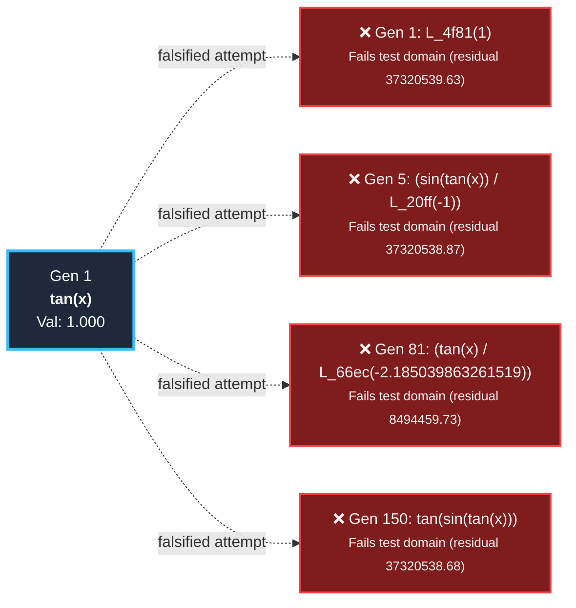

# Active Mathematical Research Frontier & Exploration Effort

> This document records open mathematical target spaces explored by the evolutionary engine that have **not yet been formally proven**, alongside the cumulative computational effort, best near-miss hypotheses, and falsification barriers encountered.

## 📊 Frontier Effort Overview

- **Open / Unsolved Problems:** 334
- **Formally Proven Discoveries:** 138
- **Cumulative Evolutionary Attempts:** 807
- **Total Expressions Evaluated:** 16,106,560
- **Total Search Generations:** 50,565
- **Dedicated Search Runtime:** 67.2m
- **Highest Near-Miss Validity on Frontier:** 100.00%

---

## 🔬 Top Open Mathematical Targets

| Rank | Target Problem | Domain | Best Validity | Nearest Candidate Formula | Attempts | Evals | Primary Failure Barrier |
|:---:|:---|:---:|:---:|:---|:---:|:---:|:---|
| 1 | `$sin(x) / (cos(x))$` | `trigonometry` | **100.00%** | `$tan(x)$` | 1 | 24000 | Validity advanced to 1.0000 |
| 2 | `$∑_{k=1}^n k^11$` | `algebra` | **100.00%** | `$n²*(n + 1)²*(2*n^8 + 8*n^7 + 4*n^6 - 16*n^5 - 5*n⁴ + 26*n³ - 3*n² - 20*n + 10)/24$` | 2 | 48000 | Validity advanced to 1.0000 |
| 3 | `$∑_{k=1}^n k^13$` | `algebra` | **100.00%** | `$n²*(n + 1)²*(30*n^10 + 150*n^9 + 125*n^8 - 400*n^7 - 326*n^6 + 1052*n^5 + 367*n⁴ - 1786*n³ + 202*n² + 1382*n - 691)/420$` | 2 | 48000 | Validity advanced to 1.0000 |
| 4 | `$∑_{k=1}^n k^17$` | `algebra` | **100.00%** | `$n²*(n + 1)²*(10*n^14 + 70*n^13 + 105*n^12 - 280*n^11 - 565*n^10 + 1410*n^9 + 2165*n^8 - 5740*n^7 - 5271*n^6 + 16282*n^5 + 5857*n⁴ - 27996*n³ + 3147*n² + 21702*n - 10851)/180$` | 2 | 48000 | Validity advanced to 1.0000 |
| 5 | `$∑_{k=1}^n k⁵$` | `algebra` | **100.00%** | `$n²*(n + 1)²*(2*n² + 2*n - 1)/12$` | 2 | 48000 | Validity advanced to 1.0000 |
| 6 | `$∑_{k=1}^n k⁷$` | `algebra` | **100.00%** | `$n²*(n + 1)²*(3*n⁴ + 6*n³ - n² - 4*n + 2)/24$` | 2 | 48000 | Validity advanced to 1.0000 |
| 7 | `$∑_{k=1}^n k^8$` | `algebra` | **100.00%** | `$n*(n + 1)*(2*n + 1)*(5*n^6 + 15*n^5 + 5*n⁴ - 15*n³ - n² + 9*n - 3)/90$` | 2 | 48000 | Validity advanced to 1.0000 |
| 8 | `$∑_{k=1}^n k^9$` | `algebra` | **100.00%** | `$n²*(n + 1)²*(n² + n - 1)*(2*n⁴ + 4*n³ - n² - 3*n + 3)/20$` | 2 | 48000 | Validity advanced to 1.0000 |
| 9 | `$∑_{k=1}^n k^10$` | `algebra` | **100.00%** | `$n*(n + 1)*(2*n + 1)*(n² + n - 1)*(3*n^6 + 9*n^5 + 2*n⁴ - 11*n³ + 3*n² + 10*n - 5)/66$` | 2 | 48000 | Validity advanced to 1.0000 |
| 10 | `$∑_{k=1}^n k^12$` | `algebra` | **100.00%** | `$n*(n + 1)*(2*n + 1)*(105*n^10 + 525*n^9 + 525*n^8 - 1050*n^7 - 1190*n^6 + 2310*n^5 + 1420*n⁴ - 3285*n³ - 287*n² + 2073*n - 691)/2730$` | 2 | 48000 | Validity advanced to 1.0000 |
| 11 | `$∑_{k=1}^n k^14$` | `algebra` | **100.00%** | `$n*(n + 1)*(2*n + 1)*(3*n^12 + 18*n^11 + 24*n^10 - 45*n^9 - 81*n^8 + 144*n^7 + 182*n^6 - 345*n^5 - 217*n⁴ + 498*n³ + 44*n² - 315*n + 105)/90$` | 2 | 48000 | Validity advanced to 1.0000 |
| 12 | `$∑_{k=1}^n k^15$` | `algebra` | **100.00%** | `$n²*(n + 1)²*(3*n^12 + 18*n^11 + 21*n^10 - 60*n^9 - 83*n^8 + 226*n^7 + 203*n^6 - 632*n^5 - 226*n⁴ + 1084*n³ - 122*n² - 840*n + 420)/48$` | 2 | 48000 | Validity advanced to 1.0000 |
| 13 | `$∑_{k=1}^n k^16$` | `algebra` | **100.00%** | `$n*(n + 1)*(2*n + 1)*(15*n^14 + 105*n^13 + 175*n^12 - 315*n^11 - 805*n^10 + 1365*n^9 + 2775*n^8 - 4845*n^7 - 6275*n^6 + 11835*n^5 + 7485*n⁴ - 17145*n³ - 1519*n² + 10851*n - 3617)/510$` | 2 | 48000 | Validity advanced to 1.0000 |
| 14 | `$∑_{k=1}^n k^18$` | `algebra` | **100.00%** | `$n*(n + 1)*(2*n + 1)*(105*n^16 + 840*n^15 + 1680*n^14 - 2940*n^13 - 9996*n^12 + 16464*n^11 + 48132*n^10 - 80430*n^9 - 167958*n^8 + 292152*n^7 + 380576*n^6 - 716940*n^5 - 454036*n⁴ + 1039524*n³ + 92162*n² - 658005*n + 219335)/3990$` | 2 | 48000 | Validity advanced to 1.0000 |
| 15 | `$∑_{k=1}^n k^19$` | `algebra` | **100.00%** | `$n²*(n + 1)²*(42*n^16 + 336*n^15 + 616*n^14 - 1568*n^13 - 4263*n^12 + 10094*n^11 + 22835*n^10 - 55764*n^9 - 87665*n^8 + 231094*n^7 + 213337*n^6 - 657768*n^5 - 236959*n⁴ + 1131686*n³ - 127173*n² - 877340*n + 438670)/840$` | 2 | 48000 | Validity advanced to 1.0000 |
| 16 | `$∑_{k=1}^n k^20$` | `algebra` | **100.00%** | `$n*(n + 1)*(2*n + 1)*(165*n^18 + 1485*n^17 + 3465*n^16 - 5940*n^15 - 25740*n^14 + 41580*n^13 + 163680*n^12 - 266310*n^11 - 801570*n^10 + 1335510*n^9 + 2806470*n^8 - 4877460*n^7 - 6362660*n^6 + 11982720*n^5 + 7591150*n⁴ - 17378085*n³ - 1540967*n² + 11000493*n - 3666831)/6930$` | 2 | 48000 | Validity advanced to 1.0000 |
| 17 | `$∑_{k=1}^n k^30$` | `algebra` | **100.00%** | `$n*(n + 1)*(2*n + 1)*(231*n²8 + 3234*n²7 + 12936*n²6 - 21021*n²5 - 217217*n²4 + 336336*n²3 + 3653650*n²2 - 5648643*n²1 - 54097043*n²0 + 83969886*n^19 + 677256580*n^18 - 1057869813*n^17 - 7003032113*n^16 + 11033483076*n^15 + 58417981930*n^14 - 93143714433*n^13 - 381864885017*n^12 + 619369184742*n^11 + 1880950772008*n^10 - 3131110750383*n^9 - 6593111576555*n^8 + 11455222740024*n^7 + 14950298960254*n^6 - 28153059810393*n^5 - 17837160922265*n⁴ + 40832271288594*n³ + 3620925455812*n² - 25847523828015*n + 8615841276005)/14322$` | 2 | 48000 | Validity advanced to 1.0000 |
| 18 | `$∑_{k=1}^n k^21$` | `algebra` | **100.00%** | `$n²*(n + 1)²*(30*n^18 + 270*n^17 + 585*n^16 - 1440*n^15 - 5020*n^14 + 11480*n^13 + 35355*n^12 - 82190*n^11 - 190745*n^10 + 463680*n^9 + 733035*n^8 - 1929750*n^7 - 1783781*n^6 + 5497312*n^5 + 1981107*n⁴ - 9459526*n³ + 1062932*n² + 7333662*n - 3666831)/660$` | 2 | 48000 | Validity advanced to 1.0000 |
| 19 | `$∑_{k=1}^n k^22$` | `algebra` | **100.00%** | `$n*(n + 1)*(2*n + 1)*(15*n²0 + 150*n^19 + 400*n^18 - 675*n^17 - 3615*n^16 + 5760*n^15 + 29220*n^14 - 46710*n^13 - 189702*n^12 + 307908*n^11 + 933064*n^10 - 1553550*n^9 - 3269646*n^8 + 5681244*n^7 + 7413782*n^6 - 13961295*n^5 - 8845327*n⁴ + 20248638*n³ + 1795584*n² - 12817695*n + 4272565)/690$` | 2 | 48000 | Validity advanced to 1.0000 |
| 20 | `$∑_{k=1}^n k^34$` | `algebra` | **100.00%** | `$n*(n + 1)*(2*n + 1)*(3*n³2 + 48*n³1 + 224*n³0 - 360*n²9 - 4808*n²8 + 7392*n²7 + 107256*n²6 - 164580*n²5 - 2160340*n²4 + 3322800*n²3 + 37818560*n²2 - 58389240*n²1 - 564958600*n²0 + 876632520*n^19 + 7087388420*n^18 - 11069398890*n^17 - 73320554770*n^16 + 115515531600*n^15 + 611693296160*n^14 - 975297710040*n^13 - 3998596474936*n^12 + 6485543567424*n^11 + 19695979462232*n^10 - 32786740977060*n^9 - 69038450348116*n^8 + 119951046010704*n^7 + 156549095132192*n^6 - 294799165703640*n^5 - 186778301351088*n⁴ + 427567034878452*n³ + 37915805126206*n² - 270657225128535*n + 90219075042845)/210$` | 2 | 48000 | Validity advanced to 1.0000 |
| 21 | `$∑_{k=1}^n k^23$` | `algebra` | **100.00%** | `$n²*(n + 1)²*(30*n²0 + 300*n^19 + 750*n^18 - 1800*n^17 - 7776*n^16 + 17352*n^15 + 69212*n^14 - 155776*n^13 - 493131*n^12 + 1142038*n^11 + 2666455*n^10 - 6474948*n^9 - 10250315*n^8 + 26975578*n^7 + 24943119*n^6 - 76861816*n^5 - 27701758*n⁴ + 132265332*n³ - 14861886*n² - 102541560*n + 51270780)/720$` | 2 | 48000 | Validity advanced to 1.0000 |
| 22 | `$∑_{k=1}^n k^24$` | `algebra` | **100.00%** | `$n*(n + 1)*(2*n + 1)*(273*n²2 + 3003*n²1 + 9009*n²0 - 15015*n^19 - 97097*n^18 + 153153*n^17 + 969969*n^16 - 1531530*n^15 - 8030022*n^14 + 12810798*n^13 + 52402714*n^12 - 85009470*n^11 - 258027882*n^10 + 429546558*n^9 + 904376004*n^8 - 1571337285*n^7 - 2050706147*n^6 + 3861727863*n^5 + 2446689429*n⁴ - 5600898075*n³ - 496674885*n² + 3545461365*n - 1181820455)/13650$` | 2 | 48000 | Validity advanced to 1.0000 |
| 23 | `$∑_{k=1}^n k^37$` | `algebra` | **100.00%** | `$—$` | 2 | 48000 | [SIMPLIFICATION] The population has achi… |
| 24 | `$∑_{k=1}^n k^26$` | `algebra` | **100.00%** | `$n*(n + 1)*(2*n + 1)*(7*n²4 + 84*n²3 + 280*n²2 - 462*n²1 - 3542*n²0 + 5544*n^19 + 42790*n^18 - 66957*n^17 - 438977*n^16 + 691944*n^15 + 3655360*n^14 - 5829012*n^13 - 23884796*n^12 + 38741700*n^11 + 117639298*n^10 - 195829797*n^9 - 412342529*n^8 + 716428692*n^7 + 935010264*n^6 - 1760729742*n^5 - 1115557926*n⁴ + 2553701760*n³ + 226457058*n² - 1616536467*n + 538845489)/378$` | 2 | 48000 | Validity advanced to 1.0000 |
| 25 | `$∑_{k=1}^n k^25$` | `algebra` | **100.00%** | `$n²*(n + 1)²*(42*n²2 + 462*n²1 + 1309*n²0 - 3080*n^19 - 16079*n^18 + 35238*n^17 + 175833*n^16 - 386904*n^15 - 1589210*n^14 + 3565324*n^13 + 11359537*n^12 - 26284398*n^11 - 61459521*n^10 + 149203440*n^9 + 236279941*n^8 - 621763322*n^7 - 574962926*n^6 + 1771689174*n^5 + 638548653*n⁴ - 3048786480*n³ + 342572785*n² + 2363640910*n - 1181820455)/1092$` | 2 | 48000 | Validity advanced to 1.0000 |

---

## 📁 Detailed Problem Dossiers & Failure Analysis

### 1. Trigonometric Identity (sin(x) / (cos(x)))

- **Target Expression:** `$sin(x) / (cos(x))$`
- **Domain Mode:** `trigonometry`
- **Best Validity Score:** `1.0000` (100.00% numerical conformance)
- **Closest Candidate Formula:** `$tan(x)$`
- **Cumulative Effort:** 1 attempt(s) | 150 generations | 24000 evals | 6.00s CPU

> [!WARNING]
> **Falsification Diagnosis / Verification Barrier:**  
> Validity advanced to 1.0000

### 2. Discrete Sum Identity (∑_{k=1}^n k^11)

- **Target Expression:** `$∑_{k=1}^n k^11$`
- **Domain Mode:** `algebra`
- **Best Validity Score:** `1.0000` (100.00% numerical conformance)
- **Closest Candidate Formula:** `$n²*(n + 1)²*(2*n^8 + 8*n^7 + 4*n^6 - 16*n^5 - 5*n⁴ + 26*n³ - 3*n² - 20*n + 10)/24$`
- **Cumulative Effort:** 2 attempt(s) | 150 generations | 48000 evals | 12.00s CPU

> [!WARNING]
> **Falsification Diagnosis / Verification Barrier:**  
> Validity advanced to 1.0000

### 3. Discrete Sum Identity (∑_{k=1}^n k^13)

- **Target Expression:** `$∑_{k=1}^n k^13$`
- **Domain Mode:** `algebra`
- **Best Validity Score:** `1.0000` (100.00% numerical conformance)
- **Closest Candidate Formula:** `$n²*(n + 1)²*(30*n^10 + 150*n^9 + 125*n^8 - 400*n^7 - 326*n^6 + 1052*n^5 + 367*n⁴ - 1786*n³ + 202*n² + 1382*n - 691)/420$`
- **Cumulative Effort:** 2 attempt(s) | 150 generations | 48000 evals | 12.00s CPU

> [!WARNING]
> **Falsification Diagnosis / Verification Barrier:**  
> Validity advanced to 1.0000

### 4. Discrete Sum Identity (∑_{k=1}^n k^17)

- **Target Expression:** `$∑_{k=1}^n k^17$`
- **Domain Mode:** `algebra`
- **Best Validity Score:** `1.0000` (100.00% numerical conformance)
- **Closest Candidate Formula:** `$n²*(n + 1)²*(10*n^14 + 70*n^13 + 105*n^12 - 280*n^11 - 565*n^10 + 1410*n^9 + 2165*n^8 - 5740*n^7 - 5271*n^6 + 16282*n^5 + 5857*n⁴ - 27996*n³ + 3147*n² + 21702*n - 10851)/180$`
- **Cumulative Effort:** 2 attempt(s) | 150 generations | 48000 evals | 12.00s CPU

> [!WARNING]
> **Falsification Diagnosis / Verification Barrier:**  
> Validity advanced to 1.0000

### 5. Faulhaber Polynomial Degree 5

- **Target Expression:** `$∑_{k=1}^n k⁵$`
- **Domain Mode:** `algebra`
- **Best Validity Score:** `1.0000` (100.00% numerical conformance)
- **Closest Candidate Formula:** `$n²*(n + 1)²*(2*n² + 2*n - 1)/12$`
- **Cumulative Effort:** 2 attempt(s) | 150 generations | 48000 evals | 12.00s CPU

> [!WARNING]
> **Falsification Diagnosis / Verification Barrier:**  
> Validity advanced to 1.0000

### 6. Discrete Sum Identity (∑_{k=1}^n k⁷)

- **Target Expression:** `$∑_{k=1}^n k⁷$`
- **Domain Mode:** `algebra`
- **Best Validity Score:** `1.0000` (100.00% numerical conformance)
- **Closest Candidate Formula:** `$n²*(n + 1)²*(3*n⁴ + 6*n³ - n² - 4*n + 2)/24$`
- **Cumulative Effort:** 2 attempt(s) | 150 generations | 48000 evals | 12.00s CPU

> [!WARNING]
> **Falsification Diagnosis / Verification Barrier:**  
> Validity advanced to 1.0000

### 7. Discrete Sum Identity (∑_{k=1}^n k^8)

- **Target Expression:** `$∑_{k=1}^n k^8$`
- **Domain Mode:** `algebra`
- **Best Validity Score:** `1.0000` (100.00% numerical conformance)
- **Closest Candidate Formula:** `$n*(n + 1)*(2*n + 1)*(5*n^6 + 15*n^5 + 5*n⁴ - 15*n³ - n² + 9*n - 3)/90$`
- **Cumulative Effort:** 2 attempt(s) | 150 generations | 48000 evals | 12.00s CPU

> [!WARNING]
> **Falsification Diagnosis / Verification Barrier:**  
> Validity advanced to 1.0000

### 8. Discrete Sum Identity (∑_{k=1}^n k^9)

- **Target Expression:** `$∑_{k=1}^n k^9$`
- **Domain Mode:** `algebra`
- **Best Validity Score:** `1.0000` (100.00% numerical conformance)
- **Closest Candidate Formula:** `$n²*(n + 1)²*(n² + n - 1)*(2*n⁴ + 4*n³ - n² - 3*n + 3)/20$`
- **Cumulative Effort:** 2 attempt(s) | 150 generations | 48000 evals | 12.00s CPU

> [!WARNING]
> **Falsification Diagnosis / Verification Barrier:**  
> Validity advanced to 1.0000

### 9. Discrete Sum Identity (∑_{k=1}^n k^10)

- **Target Expression:** `$∑_{k=1}^n k^10$`
- **Domain Mode:** `algebra`
- **Best Validity Score:** `1.0000` (100.00% numerical conformance)
- **Closest Candidate Formula:** `$n*(n + 1)*(2*n + 1)*(n² + n - 1)*(3*n^6 + 9*n^5 + 2*n⁴ - 11*n³ + 3*n² + 10*n - 5)/66$`
- **Cumulative Effort:** 2 attempt(s) | 150 generations | 48000 evals | 12.00s CPU

> [!WARNING]
> **Falsification Diagnosis / Verification Barrier:**  
> Validity advanced to 1.0000

### 10. Discrete Sum Identity (∑_{k=1}^n k^12)

- **Target Expression:** `$∑_{k=1}^n k^12$`
- **Domain Mode:** `algebra`
- **Best Validity Score:** `1.0000` (100.00% numerical conformance)
- **Closest Candidate Formula:** `$n*(n + 1)*(2*n + 1)*(105*n^10 + 525*n^9 + 525*n^8 - 1050*n^7 - 1190*n^6 + 2310*n^5 + 1420*n⁴ - 3285*n³ - 287*n² + 2073*n - 691)/2730$`
- **Cumulative Effort:** 2 attempt(s) | 150 generations | 48000 evals | 12.00s CPU

> [!WARNING]
> **Falsification Diagnosis / Verification Barrier:**  
> Validity advanced to 1.0000

### 11. Discrete Sum Identity (∑_{k=1}^n k^14)

- **Target Expression:** `$∑_{k=1}^n k^14$`
- **Domain Mode:** `algebra`
- **Best Validity Score:** `1.0000` (100.00% numerical conformance)
- **Closest Candidate Formula:** `$n*(n + 1)*(2*n + 1)*(3*n^12 + 18*n^11 + 24*n^10 - 45*n^9 - 81*n^8 + 144*n^7 + 182*n^6 - 345*n^5 - 217*n⁴ + 498*n³ + 44*n² - 315*n + 105)/90$`
- **Cumulative Effort:** 2 attempt(s) | 150 generations | 48000 evals | 12.00s CPU

> [!WARNING]
> **Falsification Diagnosis / Verification Barrier:**  
> Validity advanced to 1.0000

### 12. Discrete Sum Identity (∑_{k=1}^n k^15)

- **Target Expression:** `$∑_{k=1}^n k^15$`
- **Domain Mode:** `algebra`
- **Best Validity Score:** `1.0000` (100.00% numerical conformance)
- **Closest Candidate Formula:** `$n²*(n + 1)²*(3*n^12 + 18*n^11 + 21*n^10 - 60*n^9 - 83*n^8 + 226*n^7 + 203*n^6 - 632*n^5 - 226*n⁴ + 1084*n³ - 122*n² - 840*n + 420)/48$`
- **Cumulative Effort:** 2 attempt(s) | 150 generations | 48000 evals | 12.00s CPU

> [!WARNING]
> **Falsification Diagnosis / Verification Barrier:**  
> Validity advanced to 1.0000

### 13. Discrete Sum Identity (∑_{k=1}^n k^16)

- **Target Expression:** `$∑_{k=1}^n k^16$`
- **Domain Mode:** `algebra`
- **Best Validity Score:** `1.0000` (100.00% numerical conformance)
- **Closest Candidate Formula:** `$n*(n + 1)*(2*n + 1)*(15*n^14 + 105*n^13 + 175*n^12 - 315*n^11 - 805*n^10 + 1365*n^9 + 2775*n^8 - 4845*n^7 - 6275*n^6 + 11835*n^5 + 7485*n⁴ - 17145*n³ - 1519*n² + 10851*n - 3617)/510$`
- **Cumulative Effort:** 2 attempt(s) | 150 generations | 48000 evals | 12.00s CPU

> [!WARNING]
> **Falsification Diagnosis / Verification Barrier:**  
> Validity advanced to 1.0000

### 14. Discrete Sum Identity (∑_{k=1}^n k^18)

- **Target Expression:** `$∑_{k=1}^n k^18$`
- **Domain Mode:** `algebra`
- **Best Validity Score:** `1.0000` (100.00% numerical conformance)
- **Closest Candidate Formula:** `$n*(n + 1)*(2*n + 1)*(105*n^16 + 840*n^15 + 1680*n^14 - 2940*n^13 - 9996*n^12 + 16464*n^11 + 48132*n^10 - 80430*n^9 - 167958*n^8 + 292152*n^7 + 380576*n^6 - 716940*n^5 - 454036*n⁴ + 1039524*n³ + 92162*n² - 658005*n + 219335)/3990$`
- **Cumulative Effort:** 2 attempt(s) | 150 generations | 48000 evals | 12.00s CPU

> [!WARNING]
> **Falsification Diagnosis / Verification Barrier:**  
> Validity advanced to 1.0000

### 15. Discrete Sum Identity (∑_{k=1}^n k^19)

- **Target Expression:** `$∑_{k=1}^n k^19$`
- **Domain Mode:** `algebra`
- **Best Validity Score:** `1.0000` (100.00% numerical conformance)
- **Closest Candidate Formula:** `$n²*(n + 1)²*(42*n^16 + 336*n^15 + 616*n^14 - 1568*n^13 - 4263*n^12 + 10094*n^11 + 22835*n^10 - 55764*n^9 - 87665*n^8 + 231094*n^7 + 213337*n^6 - 657768*n^5 - 236959*n⁴ + 1131686*n³ - 127173*n² - 877340*n + 438670)/840$`
- **Cumulative Effort:** 2 attempt(s) | 150 generations | 48000 evals | 12.00s CPU

> [!WARNING]
> **Falsification Diagnosis / Verification Barrier:**  
> Validity advanced to 1.0000

### 16. Square Pyramidal Numbers (Sum of First n Squares)

- **Target Expression:** `$∑_{k=1}^n k^20$`
- **Domain Mode:** `algebra`
- **Best Validity Score:** `1.0000` (100.00% numerical conformance)
- **Closest Candidate Formula:** `$n*(n + 1)*(2*n + 1)*(165*n^18 + 1485*n^17 + 3465*n^16 - 5940*n^15 - 25740*n^14 + 41580*n^13 + 163680*n^12 - 266310*n^11 - 801570*n^10 + 1335510*n^9 + 2806470*n^8 - 4877460*n^7 - 6362660*n^6 + 11982720*n^5 + 7591150*n⁴ - 17378085*n³ - 1540967*n² + 11000493*n - 3666831)/6930$`
- **Cumulative Effort:** 2 attempt(s) | 150 generations | 48000 evals | 12.00s CPU

> [!WARNING]
> **Falsification Diagnosis / Verification Barrier:**  
> Validity advanced to 1.0000

### 17. Nicomachus's Theorem (Sum of First n Cubes)

- **Target Expression:** `$∑_{k=1}^n k^30$`
- **Domain Mode:** `algebra`
- **Best Validity Score:** `1.0000` (100.00% numerical conformance)
- **Closest Candidate Formula:** `$n*(n + 1)*(2*n + 1)*(231*n²8 + 3234*n²7 + 12936*n²6 - 21021*n²5 - 217217*n²4 + 336336*n²3 + 3653650*n²2 - 5648643*n²1 - 54097043*n²0 + 83969886*n^19 + 677256580*n^18 - 1057869813*n^17 - 7003032113*n^16 + 11033483076*n^15 + 58417981930*n^14 - 93143714433*n^13 - 381864885017*n^12 + 619369184742*n^11 + 1880950772008*n^10 - 3131110750383*n^9 - 6593111576555*n^8 + 11455222740024*n^7 + 14950298960254*n^6 - 28153059810393*n^5 - 17837160922265*n⁴ + 40832271288594*n³ + 3620925455812*n² - 25847523828015*n + 8615841276005)/14322$`
- **Cumulative Effort:** 2 attempt(s) | 150 generations | 48000 evals | 12.00s CPU

> [!WARNING]
> **Falsification Diagnosis / Verification Barrier:**  
> Validity advanced to 1.0000

### 18. Square Pyramidal Numbers (Sum of First n Squares)

- **Target Expression:** `$∑_{k=1}^n k^21$`
- **Domain Mode:** `algebra`
- **Best Validity Score:** `1.0000` (100.00% numerical conformance)
- **Closest Candidate Formula:** `$n²*(n + 1)²*(30*n^18 + 270*n^17 + 585*n^16 - 1440*n^15 - 5020*n^14 + 11480*n^13 + 35355*n^12 - 82190*n^11 - 190745*n^10 + 463680*n^9 + 733035*n^8 - 1929750*n^7 - 1783781*n^6 + 5497312*n^5 + 1981107*n⁴ - 9459526*n³ + 1062932*n² + 7333662*n - 3666831)/660$`
- **Cumulative Effort:** 2 attempt(s) | 150 generations | 48000 evals | 12.00s CPU

> [!WARNING]
> **Falsification Diagnosis / Verification Barrier:**  
> Validity advanced to 1.0000

### 19. Square Pyramidal Numbers (Sum of First n Squares)

- **Target Expression:** `$∑_{k=1}^n k^22$`
- **Domain Mode:** `algebra`
- **Best Validity Score:** `1.0000` (100.00% numerical conformance)
- **Closest Candidate Formula:** `$n*(n + 1)*(2*n + 1)*(15*n²0 + 150*n^19 + 400*n^18 - 675*n^17 - 3615*n^16 + 5760*n^15 + 29220*n^14 - 46710*n^13 - 189702*n^12 + 307908*n^11 + 933064*n^10 - 1553550*n^9 - 3269646*n^8 + 5681244*n^7 + 7413782*n^6 - 13961295*n^5 - 8845327*n⁴ + 20248638*n³ + 1795584*n² - 12817695*n + 4272565)/690$`
- **Cumulative Effort:** 2 attempt(s) | 150 generations | 48000 evals | 12.00s CPU

> [!WARNING]
> **Falsification Diagnosis / Verification Barrier:**  
> Validity advanced to 1.0000

### 20. Nicomachus's Theorem (Sum of First n Cubes)

- **Target Expression:** `$∑_{k=1}^n k^34$`
- **Domain Mode:** `algebra`
- **Best Validity Score:** `1.0000` (100.00% numerical conformance)
- **Closest Candidate Formula:** `$n*(n + 1)*(2*n + 1)*(3*n³2 + 48*n³1 + 224*n³0 - 360*n²9 - 4808*n²8 + 7392*n²7 + 107256*n²6 - 164580*n²5 - 2160340*n²4 + 3322800*n²3 + 37818560*n²2 - 58389240*n²1 - 564958600*n²0 + 876632520*n^19 + 7087388420*n^18 - 11069398890*n^17 - 73320554770*n^16 + 115515531600*n^15 + 611693296160*n^14 - 975297710040*n^13 - 3998596474936*n^12 + 6485543567424*n^11 + 19695979462232*n^10 - 32786740977060*n^9 - 69038450348116*n^8 + 119951046010704*n^7 + 156549095132192*n^6 - 294799165703640*n^5 - 186778301351088*n⁴ + 427567034878452*n³ + 37915805126206*n² - 270657225128535*n + 90219075042845)/210$`
- **Cumulative Effort:** 2 attempt(s) | 150 generations | 48000 evals | 12.00s CPU

> [!WARNING]
> **Falsification Diagnosis / Verification Barrier:**  
> Validity advanced to 1.0000

### 21. Square Pyramidal Numbers (Sum of First n Squares)

- **Target Expression:** `$∑_{k=1}^n k^23$`
- **Domain Mode:** `algebra`
- **Best Validity Score:** `1.0000` (100.00% numerical conformance)
- **Closest Candidate Formula:** `$n²*(n + 1)²*(30*n²0 + 300*n^19 + 750*n^18 - 1800*n^17 - 7776*n^16 + 17352*n^15 + 69212*n^14 - 155776*n^13 - 493131*n^12 + 1142038*n^11 + 2666455*n^10 - 6474948*n^9 - 10250315*n^8 + 26975578*n^7 + 24943119*n^6 - 76861816*n^5 - 27701758*n⁴ + 132265332*n³ - 14861886*n² - 102541560*n + 51270780)/720$`
- **Cumulative Effort:** 2 attempt(s) | 150 generations | 48000 evals | 12.00s CPU

> [!WARNING]
> **Falsification Diagnosis / Verification Barrier:**  
> Validity advanced to 1.0000

### 22. Square Pyramidal Numbers (Sum of First n Squares)

- **Target Expression:** `$∑_{k=1}^n k^24$`
- **Domain Mode:** `algebra`
- **Best Validity Score:** `1.0000` (100.00% numerical conformance)
- **Closest Candidate Formula:** `$n*(n + 1)*(2*n + 1)*(273*n²2 + 3003*n²1 + 9009*n²0 - 15015*n^19 - 97097*n^18 + 153153*n^17 + 969969*n^16 - 1531530*n^15 - 8030022*n^14 + 12810798*n^13 + 52402714*n^12 - 85009470*n^11 - 258027882*n^10 + 429546558*n^9 + 904376004*n^8 - 1571337285*n^7 - 2050706147*n^6 + 3861727863*n^5 + 2446689429*n⁴ - 5600898075*n³ - 496674885*n² + 3545461365*n - 1181820455)/13650$`
- **Cumulative Effort:** 2 attempt(s) | 150 generations | 48000 evals | 12.00s CPU

> [!WARNING]
> **Falsification Diagnosis / Verification Barrier:**  
> Validity advanced to 1.0000

### 23. Nicomachus's Theorem (Sum of First n Cubes)

- **Target Expression:** `$∑_{k=1}^n k^37$`
- **Domain Mode:** `algebra`
- **Best Validity Score:** `1.0000` (100.00% numerical conformance)
- **Closest Candidate Formula:** `$—$`
- **Cumulative Effort:** 2 attempt(s) | 150 generations | 48000 evals | 12.00s CPU

> [!WARNING]
> **Falsification Diagnosis / Verification Barrier:**  
> [SIMPLIFICATION] The population has achieved near-perfect validity (0.9999999...

### 24. Square Pyramidal Numbers (Sum of First n Squares)

- **Target Expression:** `$∑_{k=1}^n k^26$`
- **Domain Mode:** `algebra`
- **Best Validity Score:** `1.0000` (100.00% numerical conformance)
- **Closest Candidate Formula:** `$n*(n + 1)*(2*n + 1)*(7*n²4 + 84*n²3 + 280*n²2 - 462*n²1 - 3542*n²0 + 5544*n^19 + 42790*n^18 - 66957*n^17 - 438977*n^16 + 691944*n^15 + 3655360*n^14 - 5829012*n^13 - 23884796*n^12 + 38741700*n^11 + 117639298*n^10 - 195829797*n^9 - 412342529*n^8 + 716428692*n^7 + 935010264*n^6 - 1760729742*n^5 - 1115557926*n⁴ + 2553701760*n³ + 226457058*n² - 1616536467*n + 538845489)/378$`
- **Cumulative Effort:** 2 attempt(s) | 150 generations | 48000 evals | 12.00s CPU

> [!WARNING]
> **Falsification Diagnosis / Verification Barrier:**  
> Validity advanced to 1.0000

### 25. Square Pyramidal Numbers (Sum of First n Squares)

- **Target Expression:** `$∑_{k=1}^n k^25$`
- **Domain Mode:** `algebra`
- **Best Validity Score:** `1.0000` (100.00% numerical conformance)
- **Closest Candidate Formula:** `$n²*(n + 1)²*(42*n²2 + 462*n²1 + 1309*n²0 - 3080*n^19 - 16079*n^18 + 35238*n^17 + 175833*n^16 - 386904*n^15 - 1589210*n^14 + 3565324*n^13 + 11359537*n^12 - 26284398*n^11 - 61459521*n^10 + 149203440*n^9 + 236279941*n^8 - 621763322*n^7 - 574962926*n^6 + 1771689174*n^5 + 638548653*n⁴ - 3048786480*n³ + 342572785*n² + 2363640910*n - 1181820455)/1092$`
- **Cumulative Effort:** 2 attempt(s) | 150 generations | 48000 evals | 12.00s CPU

> [!WARNING]
> **Falsification Diagnosis / Verification Barrier:**  
> Validity advanced to 1.0000

---

## 🧬 Search Effort Lineage for Top Near-Miss Target (Trigonometric Identity (sin(x) / (cos(x))))

> **Problem:** `$sin(x) / (cos(x))$`  
> **Max Validity Achieved:** `1.0000` (100.00%)  
> The diagram visualizes the evolutionary path: upper ribs mark milestones, lower ribs mark falsified counterexamples.

