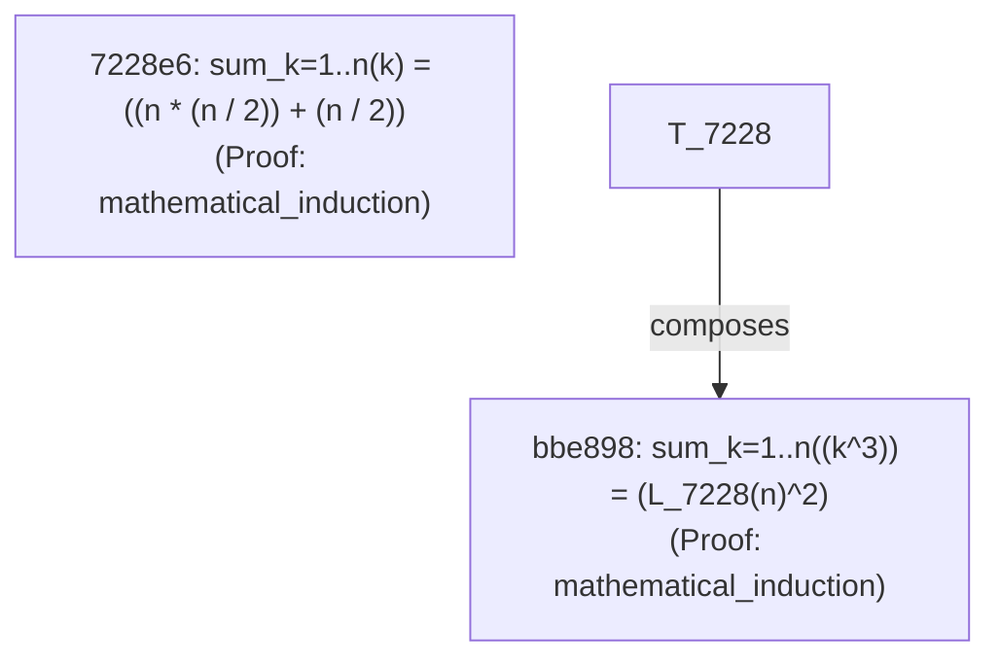

# Command-Line Interface (CLI) Reference

The engine provides a self-bootstrapping command-line interface accessible via `python src/evolutionary_math/cli.py` or as the installed console command `evolutionary-math`.

---

## Command Overview

```
python src/evolutionary_math/cli.py <command> [options]
```

Available subcommands:
- `discover`: Run targeted evolutionary search for a specific mathematical identity.
- `campaign`: Set the engine loose on an open-ended autonomous discovery campaign.
- `list`: View all verified theorems stored in the SQLite knowledge base.
- `consolidate`: Consolidate concrete numerical theorem iterations into master generalized theorems.
- `fishbone`: Export interactive HTML/SVG Ishikawa diagrams showing search lineage and attempts.
- `graph`: Export a Mermaid dependency flowchart showing how theorems compose earlier lemmas.
- `latex`: Export all verified discoveries formatted in LaTeX math syntax.
- `targets`: List all built-in example presets and instructions.
- `frontier`: Inspect open/unsolved mathematical targets, cumulative search effort, near-misses, and failure modes.

---

## 1. `discover` Subcommand

Run evolutionary search targeting a specific closed-form identity.

```powershell
python src/evolutionary_math/cli.py discover [options]
```

### Options:
| Flag | Type | Default | Description |
| :--- | :--- | :--- | :--- |
| `--target` | string | `sum_k` | Target preset (e.g. `sum_k`, `sum_k2`, `trig_pythagorean`, `geom_pythagorean`) or custom formula (e.g. `"sin(x)^2 + cos(x)^2"`) |
| `--mode` | string | `algebra` | Mathematical domain mode: `algebra`, `trigonometry`, `geometry`, `calculus` |
| `--islands` | integer | `4` | Number of isolated evolutionary islands |
| `--pop-size` | integer | `50` | Population size per island |
| `--generations` | integer | `100` | Maximum evolutionary generations |
| `--migration` | integer | `5` | Ring migration interval (generations) |
| `--stagnation` | integer | `6` | Stagnation threshold before triggering LLM advisory intervention |
| `--db` | string | `discoveries.db` | SQLite database file for theorem persistence |
| `--seed` | integer | `None` | PRNG seed for deterministic reproducibility |
| `--promote-lemmas`| flag | `True` | Automatically promote pre-existing theorems as lemmas in grammar |
| `--mock-llm` | flag | `False` | Enable offline rule-based meta-heuristic adviser |
| `--llm-url` | string | `None` | URL to OpenAI-compatible LLM endpoint (e.g. `http://localhost:11434/v1`) |
| `--llm-model` | string | `llama3` | Model name for LLM endpoint |
| `--live` | flag | `False` | Enable interactive terminal dashboard |
| `--fresh` | flag | `False` | Discard any saved checkpoint and start evolutionary search from scratch (by default, search auto-resumes where it was interrupted) |

### Examples:
```powershell
# Targeted search for telescoping rational sum (algebra mode)
python src/evolutionary_math/cli.py discover --target telescoping --generations 30

# Targeted search in trigonometry domain
python src/evolutionary_math/cli.py discover --target trig_pythagorean --mode trigonometry

# Targeted search in geometry domain
python src/evolutionary_math/cli.py discover --target geom_rect_perimeter --mode geometry

# Targeted search with live terminal dashboard
python src/evolutionary_math/cli.py discover --target sum_k --live

# Targeted search with local Ollama advisory guidance
python src/evolutionary_math/cli.py discover --target sum_k2 --llm-url http://localhost:11434/v1 --llm-model llama3
```

---

## 2. `campaign` Subcommand

Launch an autonomous discovery loop that continuously explores mathematical problem spaces, proves theorems, promotes them as lemmas, and attacks increasingly complex relationships.

```powershell
python src/evolutionary_math/cli.py campaign [options]
```

### Options:
| Flag | Type | Default | Description |
| :--- | :--- | :--- | :--- |
| `--mode` | string | `algebra` | Mathematical domain mode: `algebra`, `trigonometry`, `geometry`, `calculus` |
| `--max-theorems` | integer | `3` | Number of theorems to discover before terminating |
| `--continuous` | flag | `False` | Run indefinitely, discovering theorems in an open loop |
| `--generations` | integer | `45` | Maximum generations allocated per target space |
| `--islands` | integer | `4` | Number of evolutionary islands |
| `--pop-size` | integer | `40` | Population size per island |
| `--db` | string | `autonomous_discoveries.db` | SQLite database file |
| `--seed` | integer | `42` | PRNG random seed |
| `--mock-llm` | flag | `True` | Enable rule-based LLM advisory guidance |
| `--llm-url` | string | `None` | Connect to external/local LLM endpoint |
| `--fresh` | flag | `False` | Discard any saved checkpoint and start autonomous campaign from scratch (by default, campaign auto-resumes where it was interrupted) |

### Examples:
```powershell
# Discover a batch of 5 theorems in algebra mode
python src/evolutionary_math/cli.py campaign --mode algebra --max-theorems 5 --db batch1.db

# Run autonomous discovery in trigonometry mode
python src/evolutionary_math/cli.py campaign --mode trigonometry --max-theorems 3 --db trig.db

# Run continuously in background
python src/evolutionary_math/cli.py campaign --continuous --db open_ended.db
```

---

## 3. `list` Subcommand

View all stored theorems, proof methods, and dependency relationships.

```powershell
python src/evolutionary_math/cli.py list --db cumulative_discoveries.db
```

Output:
```
================================================================================
STORED MATHEMATICAL DISCOVERIES (cumulative_discoveries.db)
================================================================================
1. [7228e66d] sum_k=1..n(k) = ((n * (n / 2)) + (n / 2))
   Proof: mathematical_induction | Gen: 44
   💡 This is the classical triangular number formula: 1 + 2 + ... + n = n(n+1)/2. Visually, pairing two identical step-pyramids of dots creates an n × (n+1) rectangle of n(n+1) dots; dividing this rectangle in half gives the exact sum of the first n positive integers.
2. [bbe89820] sum_k=1..n((k^3)) = (L_7228(n)^2)
   Proof: mathematical_induction | Gen: 0 | Dependencies: L_7228
   💡 This is Nicomachus's Theorem: the sum of the first n cubes (1³ + 2³ + ... + n³) is exactly equal to the square of the sum of the first n integers: [n(n+1)/2]² by composing previous lemmas (L_7228).
```

---

## 4. `graph` Subcommand

Generate a Mermaid flowchart diagram showing how theorems compose earlier discoveries.

```powershell
python src/evolutionary_math/cli.py graph --db cumulative_discoveries.db
```

Paste the output directly into any Markdown viewer or GitHub issue to visualize the knowledge graph:



---

## 5. `latex` Subcommand

Export all verified discoveries formatted in LaTeX display math:

```powershell
python src/evolutionary_math/cli.py latex --db cumulative_discoveries.db
```

Output:
```latex
% Exported LaTeX Discoveries
% Theorem 7228e66d (Proof: mathematical_induction)
\[ n \cdot \frac{n}{2} + \frac{n}{2} \]
% Theorem bbe89820 (Proof: mathematical_induction)
\[ \mathrm{L_7228}\left(n\right)^{2} \]
```

---

## 6. `targets` Subcommand

List all built-in example targets with their mathematical identities, expected closed forms, difficulty levels, and ready-to-run CLI commands:

```powershell
python src/evolutionary_math/cli.py targets
```

### Preset Catalog:
| Key | Target (Math) | Expected Formula | Difficulty | Description |
| :--- | :--- | :--- | :--- | :--- |
| `sum_k` | $\sum_{k=1}^n k$ | `n*(n + 1)/2` | Easy | Triangular numbers: $1 + 2 + \dots + n$ |
| `sum_k2` | $\sum_{k=1}^n k^2$ | `n*(n + 1)*(2n + 1)/6` | Medium | Square pyramidal numbers: $1^2 + 2^2 + \dots + n^2$ |
| `sum_k3` | $\sum_{k=1}^n k^3$ | `n²*(n + 1)²/4` | Medium / Fast | Nicomachus's Theorem: $1^3 + 2^3 + \dots + n^3 = (\sum k)^2$ |
| `sum_k4` | $\sum_{k=1}^n k^4$ | `n*(n + 1)*(2n + 1)*(3n² + 3n - 1)/30` | Hard | Quartic power sum: $1^4 + 2^4 + \dots + n^4$ |
| `sum_const` | $\sum_{k=1}^n 1$ | `n` | Trivial | Discrete counting identity |
| `sum_odd` | $\sum_{k=1}^n (2k - 1)$ | `n²` | Easy | Consecutive odd numbers: $1 + 3 + 5 + \dots = n^2$ |
| `sum_even` | $\sum_{k=1}^n 2k$ | `n*(n + 1)` | Easy | Consecutive even numbers (oblong/pronic): $2 + 4 + \dots$ |
| `sum_shifted`| $\sum_{k=1}^n (k + 1)$ | `n*(n + 3)/2` | Easy | Shifted triangular sequence: $2 + 3 + 4 + \dots$ |
| `sum_pronic` | $\sum_{k=1}^n k(k + 1)$ | `n*(n + 1)*(n + 2)/3` | Medium | Consecutive products: $1\cdot 2 + 2\cdot 3 + \dots$ |
| `sum_pronic_gen` | $\sum_{k=1}^n k(k + m)$ | `n*(n + 1)*(2n + 3m + 1)/6` | General | Generalized pronic identity holding for all parameters $m$ |
| `sum_shifted_gen` | $\sum_{k=1}^n (k + m)$ | `n*(2m + n + 1)/2` | General | Generalized shifted arithmetic progression holding for all $m$ |
| `telescoping`| $\sum_{k=1}^n \frac{1}{k(k + 1)}$ | `n/(n + 1)` | Medium | Harmonic telescoping series |
| `shifted_telescoping` | $\sum_{k=1}^n \frac{1}{(k + 1)(k + 2)}$ | `n/(2*(n + 2))` | Medium | Shifted harmonic telescoping series |

---

## 7. `consolidate` Subcommand

Scan an existing database for clusters of redundant concrete iterations (e.g. $\sum k(k+1), \dots, \sum k(k+110)$), lift them into a generalized meta-theorem with symbolic free parameter $m$, prove the master identity by induction across all $m$, and purge the redundant concrete copies.

```powershell
python src/evolutionary_math/cli.py consolidate --db autonomous_discoveries.db
```

Output:
```
================================================================================
KNOWLEDGE BASE CONSOLIDATION (autonomous_discoveries.db)
================================================================================
  Found 68 concrete theorems in family sum_k=1..n(k*(k + m))
  => Successfully proved master generalized theorem:
     sum_k=1..n(k*(k + m)) = n*(n + 1)*(2*n + 3*m + 1)/6
     (Verified by mathematical induction over all parameters m)
  => Purged 68 redundant concrete theorems from database.

Consolidated 68 concrete instances into 1 master generalized theorem.
Database total theorems reduced from 79 to 12.
```

### Custom Targets:
You can also pass arbitrary custom summands directly:
```powershell
python src/evolutionary_math/cli.py discover --target "2*k + 1"
python src/evolutionary_math/cli.py discover --target "k^2 + 3*k"
```

---

## 8. `frontier` Subcommand

Track and document targets that the evolutionary engine has explored but **not yet formally proven**, capturing the cumulative computational effort (attempts, generations, individual candidate evaluations, CPU runtime), highest validity score reached, nearest-miss algebraic hypothesis, and specific falsification/failure barriers.

```powershell
python src/evolutionary_math/cli.py frontier [options]
```

### Options:
| Flag | Type | Default | Description |
| :--- | :--- | :--- | :--- |
| `--db` | string | `autonomous_discoveries.db` | SQLite database file tracking search history and target registry |
| `--mode` | choice | `all` | Filter frontier by domain mode: `algebra`, `trigonometry`, `geometry`, `calculus`, `all` |
| `--limit` | integer | `25` | Maximum number of open targets to display |
| `--export-md` | string | `None` | Export publication-ready Markdown report to file (e.g. `FRONTIER.md`) |
| `--title` | string | `Active Mathematical Research Frontier...` | Custom title for Markdown export |
| `--unattempted` | flag | `False` | Display unattempted curriculum targets waiting on the horizon |

### Examples:
```powershell
# View top 10 open unsolved targets in terminal
python src/evolutionary_math/cli.py frontier --limit 10

# Export comprehensive FRONTIER.md tracking all open targets and effort
python src/evolutionary_math/cli.py frontier --export-md FRONTIER.md

# Inspect open targets in trigonometry
python src/evolutionary_math/cli.py frontier --mode trigonometry

# View unattempted curriculum targets waiting on horizon
python src/evolutionary_math/cli.py frontier --unattempted
```


