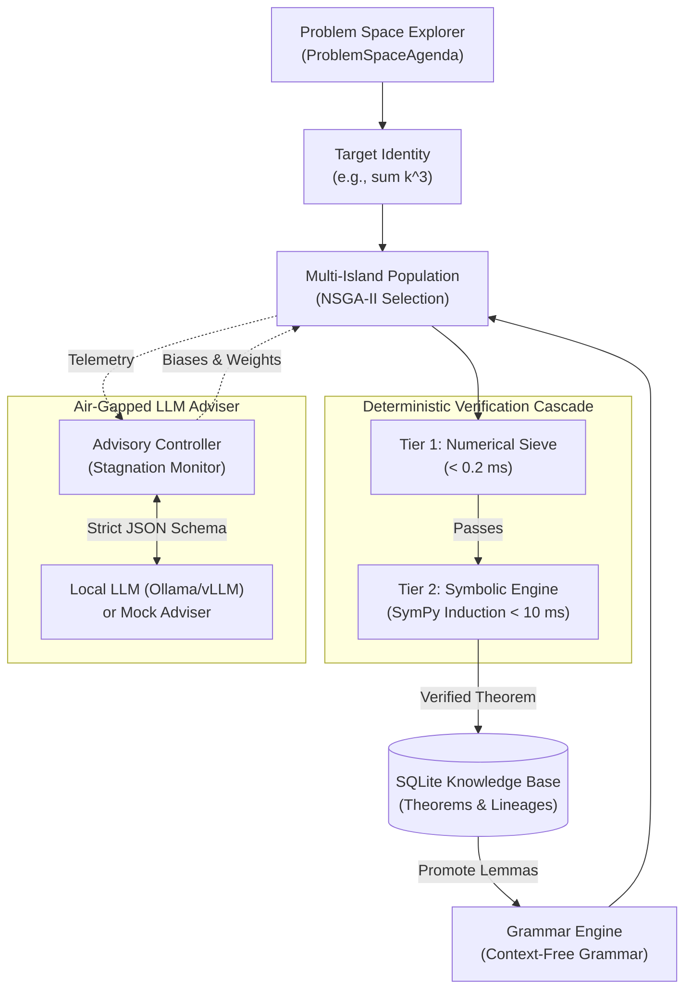

# Evolutionary Mathematical Discovery Engine Documentation

The **Evolutionary Mathematical Discovery Engine** is an autonomous research platform and Python library that explores mathematical problem spaces, synthesizes candidate relationships, deterministically verifies them via symbolic induction and algebraic canonicalization, and accumulates verified theorems into a persistent knowledge base for cumulative reuse.

---

## The Core Paradigm

$$\text{Deterministic Computation performs the Search & Proofs} \iff \text{Air-Gapped LLM provides Meta-Heuristic Guidance}$$

1. **Deterministic Foundations:** The LLM is **never** asked to certify a proof, decide truth, or generate unrestricted expressions outside the evolutionary grammar. Mathematical truth is verified exclusively by deterministic algorithms (NumPy vectorized falsification, SymPy symbolic zero-equivalence, and mathematical induction).
2. **Cumulative Mathematical Evolution:** Verified theorems are automatically promoted into the grammar as **Automatically Defined Functions (ADFs)**, allowing subsequent evolutionary searches to build upon earlier foundational discoveries (e.g. discovering Nicomachus's Theorem $\sum k^3 = (\sum k)^2$ by reusing $\sum k = \frac{n(n+1)}{2}$).
3. **Multi-Objective Optimization (NSGA-II):** Avoids collapsing mathematical fitness into an arbitrary scalar. Simultaneously balances:
   - **Validity:** Numerical consistency and proof distance.
   - **Simplicity:** Minimum Description Length (MDL) penalizing syntactic bloat.
   - **Novelty:** Structural uniqueness against the population and knowledge base.

---

## Documentation Roadmap

- **[In Plain English: How It Works](how_it_works_plain_english.md):** High-level, intuitive walkthrough with zero unnecessary jargon, explaining how formulas are born, tested, proven, and audited.
- **[System Architecture](architecture.md):** Component-level breakdown of the representation engine, multi-tier verification pipeline, island topologies, and the air-gapped advisory contract.
- **[Library Developer Guide](library_guide.md):** Complete tutorial and API reference for integrating `evolutionary_math` into your Python applications.
- **[Methodology & Mathematical Foundations](methodology.md):** Deep-dive into Context-Free Grammars, hash-consed DAGs, algebraic canonicalization, and symbolic mathematical induction.
- **[Abilities, Benchmarks & Theoretical Limitations](abilities_and_limits.md):** Honest analysis of what the engine excels at, empirical performance benchmarks, and fundamental mathematical limitations (Richardson's theorem, undecidability, search space explosion).
- **[Command-Line Interface (CLI) Reference](cli_reference.md):** Complete guide to the CLI subcommands (`discover`, `campaign`, `list`, `frontier`, `fishbone`, `history`, `targets`, `consolidate`, `export`, `graph`, `latex`).

---

## Quick Navigation

